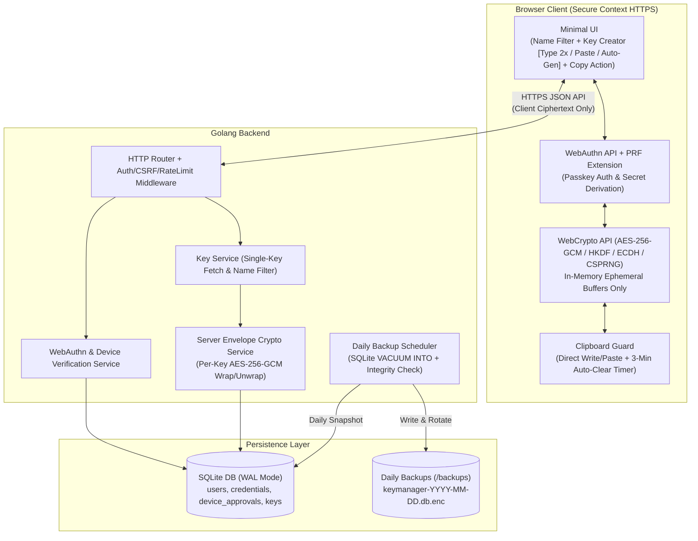
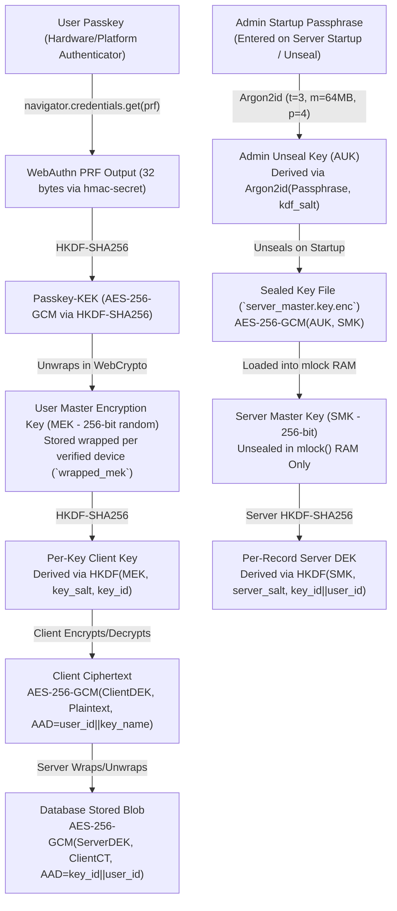
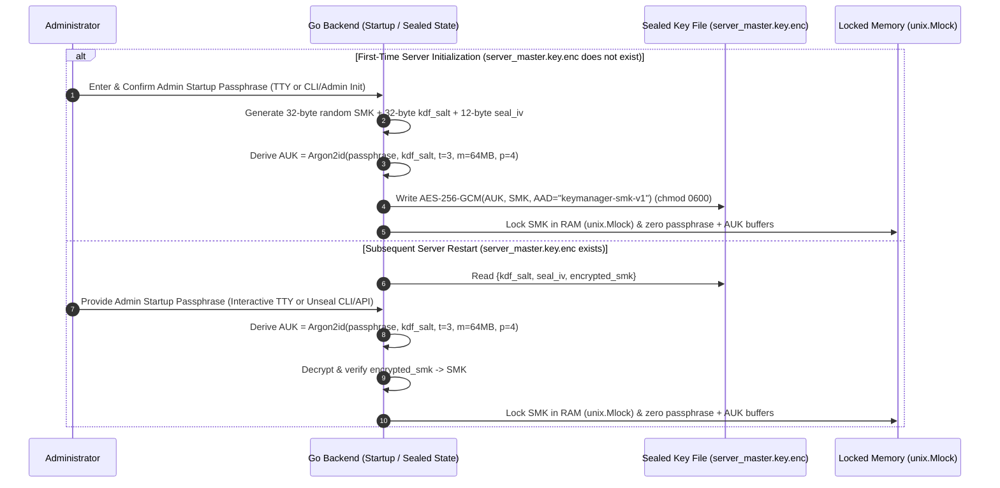
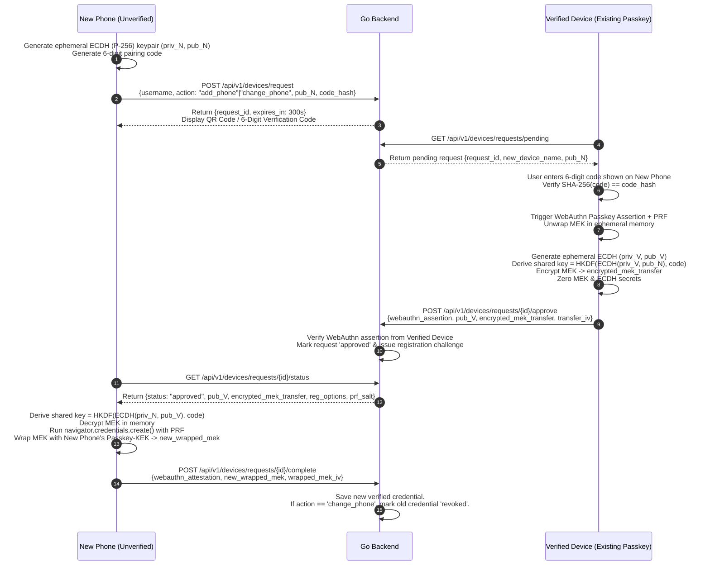
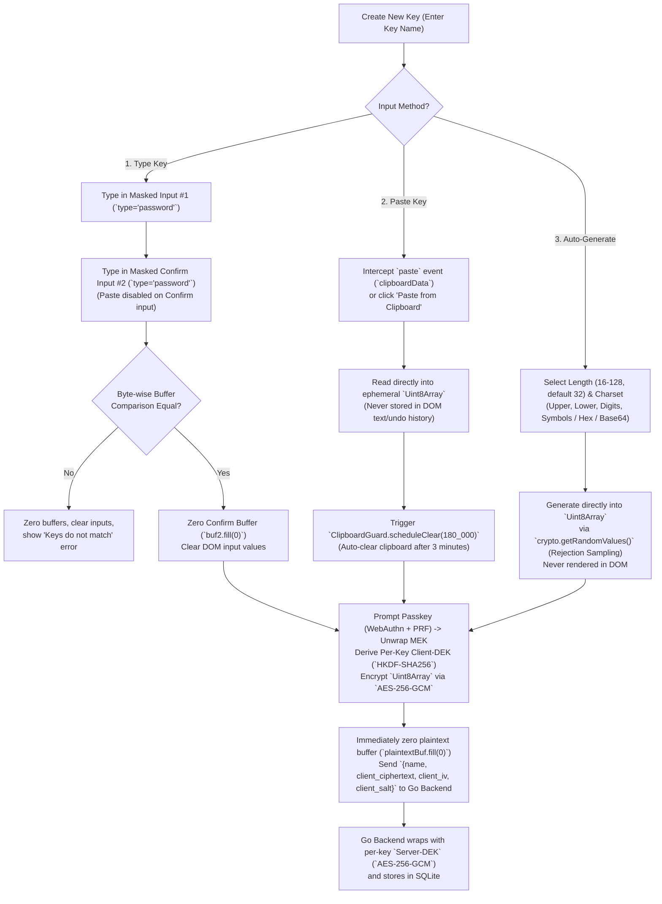

# Web Password & Key Manager — Architecture & Implementation Plan

## 1. Executive Summary & Core Security Principles

This document outlines the architecture and implementation plan for a zero-knowledge, Passkey-native web password and key manager built with a **Golang** backend and **SQLite** database.

### Core Guarantees
1. **Zero Plaintext Exposure (Client & Server)**:
   - Plaintext keys/passwords are **never** sent to, processed by, or stored on the server.
   - Plaintext is **never** displayed on screen (no reveal/view UI, no DOM text rendering) and **never** persisted on the client device (`localStorage`, `sessionStorage`, `IndexedDB`, cookies, or cache).
2. **Passkey-Only Authentication & Decryption**:
   - Users register and authenticate exclusively using **WebAuthn / FIDO2 Passkeys** (`userVerification: "required"`).
   - Client-side encryption and decryption are cryptographically bound to the user's Passkey via the **WebAuthn PRF (Pseudo-Random Function) extension (`hmac-secret`)** and the browser's **WebCrypto API (`AES-256-GCM`)**.
3. **Dual-Layer Encryption (Client E2EE + Server Backend Per-Key Envelope Encryption with Admin Passphrase Unseal)**:
   - **Inner Layer (Client E2EE)**: Every key is encrypted in browser memory using a key derived from the Passkey before transmission.
   - **Outer Layer (Server Backend)**: The Go backend independently encrypts each key record again using server-side `AES-256-GCM` envelope encryption with a per-key Data Encryption Key (`Server-DEK`) derived from the **Server Master Key (`SMK`)**.
   - **Vault-Style Admin Startup Passphrase Unseal**: The raw `SMK` is **never** stored in plaintext on disk, in environment variables, or in SQLite. It is stored sealed on disk (`server_master.key.enc`) encrypted via `Argon2id` + `AES-256-GCM` using an **Admin Startup Passphrase**. On server startup/restart, the admin provides the passphrase to unseal `SMK` into `mlock`-protected RAM.
4. **Flexible, Zero-Plaintext Key Creation (Type Twice, Paste with 3-Min Clear, or Auto-Generate)**:
   - **Type Manually**: Because plaintext is never shown on screen, users typing a key manually must **input the key twice** (masked primary & confirmation inputs) for byte-level verification before encryption.
   - **Paste Key**: Users can paste a key directly; since the pasted secret resides in the OS clipboard, pasting automatically starts the **3-minute (180-second) clipboard auto-clear timer**.
   - **Auto-Generate Key**: Users can generate high-entropy keys in memory using `crypto.getRandomValues()` (configurable length/charset) without ever rendering the generated secret in the DOM.
5. **Verified-Device Approval for Adding/Changing a Phone**:
   - Adding a new phone/passkey or replacing an existing phone requires cryptographic verification and explicit approval from an **already-verified device**, which securely transfers the wrapped Master Encryption Key (MEK) using ephemeral ECDH (`P-256`) signed by the verified device's Passkey assertion.
6. **Single-Key Retrieval & Name Filtering**:
   - Users can filter keys by `name` via a metadata-only search endpoint (which never returns key ciphertexts).
   - Ciphertext retrieval is strictly enforced as **one key at a time** (`POST /api/v1/keys/{id}/retrieve`), gated by active Passkey authentication and rate-limiting.
7. **Direct-to-Clipboard Decryption & 3-Minute Auto-Clear**:
   - Decrypting a key writes the decrypted bytes directly into the system clipboard via `navigator.clipboard.write()` inside a transient `Uint8Array` buffer that is immediately zeroed (`buffer.fill(0)`).
   - Both **copying a decrypted key** and **pasting a new key** trigger a 3-minute (180-second) timer that automatically purges the clipboard (`navigator.clipboard.writeText("")`), with focus/visibility fallback handlers if the tab is backgrounded.
8. **Automated Daily SQLite Backups**:
   - An embedded Go scheduler runs daily online backups using SQLite's atomic `VACUUM INTO` command, verifies backup integrity (`PRAGMA integrity_check`), compresses/encrypts the snapshot, and enforces retention policies.
9. **Strict Capacity & Size Limits (10KB Per-Key, 1,000 Keys/User, 10,000 Keys/IP)**:
   - **Per-Key Size Limit**: Enforced at maximum 10KB (10,240 bytes) client-side before encryption (for manual typing, pasting, and auto-generation) and server-side on creation and update.
   - **Per-User Key Limit**: Strictly capped at 1,000 keys per user (`SELECT COUNT(*) FROM keys WHERE user_id = ?`).
   - **Per-IP Key Limit**: Strictly capped at 10,000 keys per IP (`SELECT COUNT(*) FROM keys WHERE creator_ip = ?`).

---

## 2. System Architecture & Technology Stack

### Technology Stack
| Layer | Technology | Rationale |
| :--- | :--- | :--- |
| **Backend Language** | Go 1.22+ | Strong standard library (`net/http`, `crypto/cipher`, `crypto/ecdh`, `embed`), memory safety, single static binary deployment. |
| **WebAuthn / Passkey** | `github.com/go-webauthn/webauthn` | Standards-compliant FIDO2 / WebAuthn Relying Party implementation for Go. |
| **Database** | SQLite 3 (`modernc.org/sqlite` or `mattn/go-sqlite3`) | Embedded relational DB configured with `WAL` mode, foreign keys, and online `VACUUM INTO` backup support. |
| **Frontend** | Vanilla ES2022+ JS, HTML5, CSS3 (served via Go `embed.FS`) | Zero third-party JS supply-chain risk; direct access to `navigator.credentials` (WebAuthn + PRF), `window.crypto.subtle` (WebCrypto), and `navigator.clipboard`. |
| **Transport Security** | HTTP (default `localhost:8082`) behind Reverse Proxy (Caddy / Cloudflare with TLS 1.3), or direct TLS via `--tls` | Backend serves plain HTTP on `localhost:8082` by default for reverse proxy deployment (Caddy / Cloudflare terminating TLS), with dynamic `X-Forwarded-Proto`, `X-Forwarded-Host`, `Host` handling for WebAuthn RP/Origin and session cookies, and direct TLS support via `--tls` or `TLS_CERT`/`TLS_KEY`. |

### High-Level Architecture Diagram



---

## 3. Cryptographic Design (Passkey Decryption + Server Backend Encryption)

To satisfy **"decrypt use passkey"**, **"each key is encrypted on server backend"**, **"never show/store plaintext on device or server"**, and **"if user add/change phone, verify on verified device"**, the system uses a **Two-Tier Client Key Hierarchy** combined with **Server-Side Envelope Encryption**.

### 3.1 Key Hierarchy



1. **Passkey PRF Secret (`Passkey-KEK`)**:
   - Each registered Passkey credential has an associated 32-byte random `prf_salt`.
   - During WebAuthn authentication (`navigator.credentials.get`), the browser passes `extensions: { prf: { eval: { first: prf_salt } } }`.
   - The authenticator returns a deterministic 32-byte secret unique to that credential.
   - WebCrypto imports this output and derives a non-extractable `AES-256-GCM` wrapping key (`Passkey-KEK`) via `HKDF-SHA256`.
2. **User Master Encryption Key (`MEK`)**:
   - Because a user may change phones or add a secondary verified device (and two different passkeys produce different PRF outputs), keys are encrypted under a user-specific random 256-bit `MEK`.
   - For each verified device/passkey, `MEK` is wrapped (`AES-256-GCM`) using that device's `Passkey-KEK` and stored in the `credentials.wrapped_mek` column.
3. **Client-Side Per-Key Encryption (E2EE)**:
   - When saving a key, the browser generates a random 32-byte `client_salt` and 12-byte `client_iv`.
   - It derives a per-key `AES-256-GCM` key from `MEK` + `client_salt` using `HKDF-SHA256` (info: `key_name`).
   - It encrypts the secret bytes in memory, zeroes the input buffer immediately, and sends `{ name, client_ciphertext, client_iv, client_salt }` to the server.
4. **Server-Side Per-Key Encryption (Backend Envelope Encryption)**:
   - Upon receiving `{ client_ciphertext }`, the Go backend generates a 32-byte `server_salt` and 12-byte `server_iv`.
   - Using the in-memory Server Master Key (`SMK`, unsealed at startup via the Admin Startup Passphrase and locked in RAM via `unix.Mlock`), the backend derives a unique per-key `Server-DEK` via `HKDF-SHA256(SMK, server_salt, key_id || user_id)`.
   - The backend encrypts `client_ciphertext` with `AES-256-GCM` (binding `key_id || user_id` as Additional Authenticated Data `AAD`) and stores the resulting `server_ciphertext` in SQLite.
   - When returning a single key, the server decrypts the outer layer (`server_ciphertext` -> `client_ciphertext`) and returns it to the client.

---

### 3.2 Server Master Key (`SMK`) Seal/Unseal Lifecycle (Admin Startup Passphrase)

To ensure the Server Master Key (`SMK`) **never disappears across restarts** while **never sitting in plaintext on disk or in environment variables**, the backend uses a Vault-style **Admin Startup Passphrase** mechanism (`internal/crypto/seal.go`).



1. **First-Time Initialization (Generating & Sealing `SMK`)**:
   - When the server starts for the first time and `server_master.key.enc` does not exist:
     - The admin is prompted to enter and confirm an **Admin Startup Passphrase** (minimum 12 characters).
     - Go generates a cryptographically random 32-byte `SMK`, a 32-byte `kdf_salt`, and a 12-byte `seal_iv` via `crypto/rand`.
     - Go derives a 32-byte **Admin Unseal Key (`AUK`)** from the passphrase using **`Argon2id`** (`golang.org/x/crypto/argon2`, `time=3`, `memory=64*1024` KiB, `threads=4`, `keyLen=32`).
     - `SMK` is encrypted with `AES-256-GCM` under `AUK` (`AAD = "keymanager-smk-v1"`) and written atomically to `server_master.key.enc` (`chmod 0600`, stored outside the SQLite directory).
     - The passphrase and `AUK` byte slices are immediately zeroed (`clear(buf)`), and `SMK` is locked in process memory using `unix.Mlock(smk)` so the OS kernel never swaps `SMK` to disk.

2. **Server Restart & Unseal Modes**:
   - **Mode 1: Interactive Terminal Startup**:
     - If started interactively with a TTY attached, the Go binary prompts `Enter Admin Startup Passphrase:` using `golang.org/x/term.ReadPassword` (no echo), unseals `server_master.key.enc` into RAM, and begins serving HTTPS requests.
   - **Mode 2: Background Service / Daemon Boot (`Sealed Mode` -> Unseal)**:
     - If started as a non-interactive background service (e.g., `systemd` or container restart), the server boots in **Sealed Mode**:
       - All `/api/v1/keys/*` and `/api/v1/auth/*` endpoints return `503 Service Unavailable` (`{"error": "server_sealed"}`).
       - The admin can unseal the server either by running `./keymanager unseal` (which communicates over a root-only local Unix socket `/run/keymanager/admin.sock`) or via the rate-limited admin unseal endpoint (`POST /api/v1/admin/unseal`).
       - Once the passphrase is verified and `SMK` is decrypted into `mlock` RAM, the server transitions to **Unsealed Mode** and operates normally.

3. **Admin Passphrase Rotation (Strictly a CLI Operation Requiring Current Passphrase)**:
   - Passphrase rotation is strictly a local CLI operation (`./keymanager rotate-passphrase`) and is intentionally **never exposed over HTTP/web**.
   - Executing rotation strictly requires the **current (old) Admin Startup Passphrase** to authenticate and decrypt `server_master.key.enc`. If the old passphrase is missing or incorrect, rotation fails immediately (`ErrAuthentication`) and the file remains untouched.
   - Upon successful verification, the existing `SMK` is re-encrypted with a fresh Argon2id salt and AES-GCM IV under the new passphrase without modifying any row in SQLite.

---

## 4. Database Schema (SQLite)

SQLite will be initialized with:
```sql
PRAGMA journal_mode = WAL;
PRAGMA synchronous = NORMAL;
PRAGMA foreign_keys = ON;
PRAGMA busy_timeout = 5000;
PRAGMA secure_delete = ON; -- Overwrites deleted records with zeroes in SQLite
```

### DDL (`schema.sql`)

```sql
-- 1. Users table
CREATE TABLE IF NOT EXISTS users (
    id TEXT PRIMARY KEY,                     -- UUIDv4
    username TEXT NOT NULL UNIQUE,           -- User handle / identifier
    display_name TEXT NOT NULL,
    created_at DATETIME NOT NULL DEFAULT CURRENT_TIMESTAMP,
    updated_at DATETIME NOT NULL DEFAULT CURRENT_TIMESTAMP
);

-- 2. Passkey Credentials (Verified Devices)
CREATE TABLE IF NOT EXISTS credentials (
    id BLOB PRIMARY KEY,                     -- WebAuthn CredentialID
    user_id TEXT NOT NULL,
    device_name TEXT NOT NULL,               -- e.g., "iPhone 16 Pro", "Pixel 9"
    public_key BLOB NOT NULL,                -- COSE Public Key
    attestation_type TEXT NOT NULL,
    aaguid BLOB,
    sign_count INTEGER NOT NULL DEFAULT 0,
    transports TEXT,                         -- JSON array of transports
    backup_eligible BOOLEAN NOT NULL DEFAULT 0,
    backup_state BOOLEAN NOT NULL DEFAULT 0,
    prf_salt BLOB NOT NULL,                  -- 32-byte salt for WebAuthn PRF extension
    wrapped_mek BLOB NOT NULL,               -- User MEK wrapped by this Passkey's PRF-derived KEK
    wrapped_mek_iv BLOB NOT NULL,            -- 12-byte AES-GCM IV for wrapped_mek
    status TEXT NOT NULL DEFAULT 'verified', -- 'verified' | 'revoked'
    created_at DATETIME NOT NULL DEFAULT CURRENT_TIMESTAMP,
    last_used_at DATETIME,
    FOREIGN KEY (user_id) REFERENCES users(id) ON DELETE CASCADE
);

CREATE INDEX IF NOT EXISTS idx_credentials_user_id ON credentials(user_id);

-- 3. Device Addition / Phone Change Verification Requests
CREATE TABLE IF NOT EXISTS device_verification_requests (
    id TEXT PRIMARY KEY,                     -- UUIDv4
    user_id TEXT NOT NULL,
    action_type TEXT NOT NULL,               -- 'add_phone' | 'change_phone'
    replace_credential_id BLOB,              -- Populated if replacing a specific old phone
    new_device_name TEXT NOT NULL,
    verification_code_hash TEXT NOT NULL,    -- SHA-256 of short 6-digit pairing code shown on new phone
    new_device_ecdh_pub BLOB NOT NULL,       -- Ephemeral P-256 public key generated by new phone
    approver_ecdh_pub BLOB,                  -- Ephemeral P-256 public key from verified device
    encrypted_mek_transfer BLOB,             -- MEK encrypted under ECDH shared secret by verified device
    transfer_iv BLOB,                        -- 12-byte IV for MEK transfer
    approved_by_credential_id BLOB,          -- Verified credential that signed the approval
    status TEXT NOT NULL DEFAULT 'pending',  -- 'pending' | 'approved' | 'completed' | 'expired' | 'rejected'
    expires_at DATETIME NOT NULL,            -- Strict 5-minute TTL
    created_at DATETIME NOT NULL DEFAULT CURRENT_TIMESTAMP,
    FOREIGN KEY (user_id) REFERENCES users(id) ON DELETE CASCADE
);

CREATE INDEX IF NOT EXISTS idx_device_req_user_status ON device_verification_requests(user_id, status);

-- 4. Encrypted Keys Table
CREATE TABLE IF NOT EXISTS keys (
    id TEXT PRIMARY KEY,                     -- UUIDv4
    user_id TEXT NOT NULL,
    name TEXT NOT NULL,                      -- Key name for filtering (indexed per user)
    name_normalized TEXT NOT NULL,           -- Lowercase normalized name for fast filtering
    server_ciphertext BLOB NOT NULL,         -- Outer server AES-256-GCM(inner client AES-256-GCM ciphertext)
    server_iv BLOB NOT NULL,                 -- 12-byte IV for server encryption layer
    server_salt BLOB NOT NULL,               -- 32-byte salt for server per-key HKDF
    client_iv BLOB NOT NULL,                 -- 12-byte IV for client E2EE layer
    client_salt BLOB NOT NULL,               -- 32-byte salt for client per-key HKDF
    creator_ip TEXT,                         -- IP address of creator for per-IP limit enforcement
    created_at DATETIME NOT NULL DEFAULT CURRENT_TIMESTAMP,
    updated_at DATETIME NOT NULL DEFAULT CURRENT_TIMESTAMP,
    UNIQUE(user_id, name_normalized),
    FOREIGN KEY (user_id) REFERENCES users(id) ON DELETE CASCADE
);

CREATE INDEX IF NOT EXISTS idx_keys_user_name ON keys(user_id, name_normalized);
CREATE INDEX IF NOT EXISTS idx_keys_creator_ip ON keys(creator_ip);

-- 5. Audit & Backup Log Table
CREATE TABLE IF NOT EXISTS audit_logs (
    id INTEGER PRIMARY KEY AUTOINCREMENT,
    user_id TEXT,
    event_type TEXT NOT NULL,                -- 'login', 'key_fetch', 'device_verify', 'backup_success', etc.
    ip_address TEXT,
    metadata TEXT,
    created_at DATETIME NOT NULL DEFAULT CURRENT_TIMESTAMP
);
```

---

## 5. Detailed Functional Workflows

### 5.1 Passkey Registration & Login

#### Registration Flow (First Device)
1. **Begin Registration (`POST /api/v1/auth/register/begin`)**:
   - User submits `username` and `display_name`.
   - Go backend generates WebAuthn `PublicKeyCredentialCreationOptions` (`residentKey: "required"`, `userVerification: "required"`) and a 32-byte `prf_salt`.
2. **Passkey Creation & MEK Generation (Client)**:
   - Browser calls `navigator.credentials.create({ publicKey, extensions: { prf: { eval: { first: prf_salt } } } })`.
   - Using the returned PRF output (or an immediate PRF assertion if the platform authenticator requires `get()` for PRF evaluation), the browser derives `Passkey-KEK`.
   - Browser generates a random 256-bit `MEK` via `crypto.subtle.generateKey`, wraps `MEK` with `Passkey-KEK` to produce `wrapped_mek` + `wrapped_mek_iv`, and zeroes raw key material from memory.
3. **Finish Registration (`POST /api/v1/auth/register/finish`)**:
   - Client sends the WebAuthn attestation response + `wrapped_mek` + `wrapped_mek_iv` + `prf_salt`.
   - Server verifies the attestation, creates the user and initial `verified` credential record in SQLite, and issues an `HttpOnly; Secure; SameSite=Strict` session cookie.

#### Login Flow
1. **Begin Login (`POST /api/v1/auth/login/begin`)**:
   - Server generates a WebAuthn assertion challenge (`userVerification: "required"`).
2. **Finish Login (`POST /api/v1/auth/login/finish`)**:
   - Client completes `navigator.credentials.get()`, sends assertion to server.
   - Server validates signature and `sign_count`, verifies that `credential.status == 'verified'`, and establishes an authenticated session.
   - Note: `MEK` is **not** kept unwrapped in persistent memory during idle browsing; encryption/decryption is performed on-demand with Passkey verification.

---

### 5.2 Adding or Changing a Phone (Verified-Device Approval Flow)

When a user adds a new phone or changes their phone, the new phone **cannot** self-authorize or decrypt existing keys without verification on an already-verified device.



- **Why this is secure**:
  - Even if an attacker intercepts the network or compromises the server, the `MEK` is encrypted end-to-end between the verified device and the new phone using ephemeral `ECDH P-256` bound to the out-of-band 6-digit verification code via `HKDF`, and authorized by a hardware-backed WebAuthn assertion from the verified device.
  - If the user selected **Change Phone**, completing the handshake atomically revokes the old phone's credential in a single SQLite transaction.

---

### 5.3 Creating a Key: Type (Double Input), Paste (3-Min Clipboard Clear), or Auto-Generate

When creating a key, the user enters a **Key Name** (e.g., `prod-aws-root`, `github-pat`) and chooses one of three input methods. Plaintext is **never** displayed on screen in any mode.



#### Mode A: Type a Key Manually (Requires Typing Twice)
- Because there is **no "show/reveal" toggle**, typing a secret manually requires **two masked inputs**:
  1. **Enter Key** (`<input id="key-type-primary" type="password" autocomplete="new-password" spellcheck="false">`)
  2. **Confirm Key** (`<input id="key-type-confirm" type="password" autocomplete="new-password" spellcheck="false">`)
- Paste events (`paste` / `drop`) on the **Confirm Key** field are blocked so the user genuinely types the secret twice rather than pasting a potentially mistyped value.
- On submit:
  - Both inputs are encoded directly into `Uint8Array` buffers (`buf1`, `buf2`) via `TextEncoder`, and `input.value = ""` is immediately executed on both DOM inputs.
  - A constant-time byte-length and byte-equality check verifies `buf1` matches `buf2`.
  - `buf2.fill(0)` is called immediately. If they do not match, `buf1.fill(0)` is also called and an error is shown.
  - If they match, `buf1` proceeds to Passkey-backed WebCrypto encryption and is then zeroed (`buf1.fill(0)`).

#### Mode B: Paste a Key (Single Input + 3-Minute Clipboard Auto-Clear)
- Users can either click **"Paste from Clipboard"** or press `Ctrl+V` / `Cmd+V` inside the key input box:
  - **If pasting via `Ctrl+V` / `Cmd+V` (`paste` event)**:
    - The handler calls `event.preventDefault()`, reads `event.clipboardData.getData("text/plain")` directly into a `Uint8Array` via `TextEncoder`, displays a non-sensitive visual indicator (`"Pasted key captured in memory (N bytes) — ready to encrypt"`), and **automatically switches out of double-entry mode** (confirmation input is not required for pasted keys).
    - Because `event.preventDefault()` is used, the plaintext never enters the `<input>` element's DOM value or browser undo stack.
  - **3-Minute Clipboard Auto-Clear on Paste**:
    - Because the user pasted the key from their system clipboard, the plaintext secret is still sitting in the OS clipboard.
    - Immediately upon paste capture, `ClipboardGuard.scheduleClear(180 * 1000)` is started (with the visible 3-minute countdown badge `"Pasted key in clipboard — auto-clearing in 02:59..."`).
    - After 3 minutes (180 seconds), the system clipboard is automatically overwritten with `""`.

#### Mode C: Auto-Generate a Key (In-Memory CSPRNG)
- Users can select **"Auto-Generate"** and configure:
  - **Preset Mode**: `Random Password` (default 32 chars: `A-Z`, `a-z`, `0-9`, `!@#$%^&*()-_=+`), `Hex Key` (256-bit / 64 hex chars), or `Base64URL Secret` (256-bit).
  - **Length**: `16` to `128` characters.
- When the user clicks **Generate & Save**:
  - `crypto.getRandomValues()` generates unbiased random bytes directly inside an ephemeral `Uint8Array` buffer (using rejection sampling to avoid modulo bias).
  - The generated secret is **never** converted into a DOM string or displayed on screen.
  - It is immediately encrypted in WebCrypto using the Passkey-derived key, sent to the backend, and the `Uint8Array` is zeroed (`plaintextBuf.fill(0)`).
  - Optional toggle: *"Also copy generated key to clipboard (auto-clears in 3 min)"* — if checked, writes the `Blob([plaintextBytes])` to `navigator.clipboard.write()` before zeroing the buffer and starts the 3-minute clipboard clear timer.

#### 5.3.1 Capacity & Size Limits Enforcement
- **10KB Per-Key Limit (10,240 bytes)**:
  - **Manual Typing**: Validated on real-time input and submission; input rejected if UTF-8 bytes exceed 10,240.
  - **Paste**: Validated upon capture in `capturePasteDirect` and on submission; rejected with alert if pasted bytes exceed 10,240 (automatically wiping pending memory buffer and resetting UI badge).
  - **Auto-Generate**: Length and generated byte buffers validated against 10,240 bytes.
  - **Server-Side**: Decoded `client_ciphertext` payload validated before encryption on creation and update; rejected with `key_payload_too_large` if > 10,240 bytes.
- **Per-User Quota (1,000 keys)**:
  - SQLite query `SELECT COUNT(*) FROM keys WHERE user_id = ?` checked in `CreateKey` prior to key creation. Rejected if count >= 1000 with `user_key_limit_exceeded`.
  - Atomic database-level enforcement via SQLite trigger `trg_keys_user_limit` to prevent concurrent race conditions from breaching the 1,000 key limit.
- **Per-IP Quota (10,000 keys)**:
  - Caller IP extracted, stripped of ports, IPv6-canonicalized (address brackets, zero compression, and casing normalized), and stored in `creator_ip`.
  - SQLite query `SELECT COUNT(*) FROM keys WHERE creator_ip = ?` checked in `CreateKey` prior to creation. Rejected if count >= 10000 with `ip_key_limit_exceeded`.
  - Atomic database-level enforcement via SQLite trigger `trg_keys_ip_limit`.
  - Malformed or blank `X-Forwarded-For` headers safely fall back to `RemoteAddr`.

---

### 5.4 Name Filtering & Returning Strictly One Key at a Time

1. **Filtering by Name (`GET /api/v1/keys?q=<filter>`)**:
   - Returns **metadata only**:
     ```json
     {
       "keys": [
         { "id": "550e8400-e29b-41d4-a716-446655440000", "name": "github-token", "updated_at": "2026-11-06T11:00:00Z" }
       ]
     }
     ```
   - SQL query:
     ```sql
     SELECT id, name, created_at, updated_at
     FROM keys
     WHERE user_id = ? AND name_normalized LIKE ?
     ORDER BY name_normalized ASC
     LIMIT 50;
     ```
   - **Zero ciphertexts** are returned in list/filter endpoints.

2. **Single-Key Retrieval & Passkey Decryption (`POST /api/v1/keys/{id}/retrieve`)**:
   - The backend exposes **no bulk export** and **no multi-key fetch endpoint**.
   - To retrieve a single key:
     1. User clicks **"Copy Key"** next to a single item in the filtered list.
     2. Step 1 (Challenge/Passkey): Client fetches a fresh WebAuthn assertion challenge + the user's `prf_salt` (`POST /api/v1/keys/{id}/challenge`), then invokes `navigator.credentials.get()` with `userVerification: "required"` and `extensions: { prf: { eval: { first: prf_salt } } }`.
     3. Step 2 (Fetch Single Key): Client sends the WebAuthn assertion to `POST /api/v1/keys/{id}/retrieve`.
     4. Server verifies the WebAuthn assertion, enforces per-user rate limiting (max 10 single-key retrievals per minute), decrypts the outer **Server Envelope Layer** for that single `id` (`server_ciphertext` -> `client_ciphertext`), logs the audit event, and returns:
        ```json
        {
          "id": "550e8400-e29b-41d4-a716-446655440000",
          "name": "github-token",
          "client_ciphertext": "<base64>",
          "client_iv": "<base64>",
          "client_salt": "<base64>",
          "wrapped_mek": "<base64>",
          "wrapped_mek_iv": "<base64>"
        }
        ```

---

### 5.5 Direct Copy to Clipboard & Unified 3-Minute Auto-Clear (`ClipboardGuard`)

Both **copying a decrypted key** and **pasting a key during creation** activate `ClipboardGuard.scheduleClear(180 * 1000)`.

```javascript
async function copySingleKeyWithPasskey(keyId, keyNameNormalized) {
  // Cancel any previous clear timer before copying a new key
  ClipboardGuard.cancelPendingTimer();

  // Pass a Promise to ClipboardItem immediately inside the user click gesture
  // so Safari/WebKit and Chromium preserve transient user activation across WebAuthn + fetch
  const clipboardItem = new ClipboardItem({
    "text/plain": (async () => {
      // 1. Get single-key challenge & PRF salt
      const challengeRes = await fetch(`/api/v1/keys/${encodeURIComponent(keyId)}/challenge`, {
        method: "POST",
        headers: { "Cache-Control": "no-store" }
      });
      if (!challengeRes.ok) throw new Error("Failed to initialize challenge");
      const { publicKeyOptions, prfSalt } = await challengeRes.json();

      // 2. Prompt Passkey with PRF extension
      const assertion = await navigator.credentials.get({
        publicKey: decodePublicKeyRequestOptions(publicKeyOptions),
        extensions: {
          prf: { eval: { first: base64ToUint8Array(prfSalt) } }
        }
      });

      const prfOutput = new Uint8Array(assertion.getClientExtensionResults().prf.results.first);

      // 3. Fetch the single encrypted key record from backend
      const keyRes = await fetch(`/api/v1/keys/${encodeURIComponent(keyId)}/retrieve`, {
        method: "POST",
        headers: { "Content-Type": "application/json", "Cache-Control": "no-store" },
        body: JSON.stringify({ assertion: serializeAssertion(assertion) })
      });
      if (!keyRes.ok) throw new Error("Failed to retrieve encrypted key");
      const payload = await keyRes.json();

      // 4. Derive Passkey-KEK, unwrap MEK, derive per-key Client-DEK, and decrypt in WebCrypto
      const passkeyKek = await derivePasskeyKek(prfOutput, base64ToUint8Array(prfSalt));
      prfOutput.fill(0); // Zero PRF secret immediately

      const mek = await unwrapMek(
        passkeyKek,
        base64ToUint8Array(payload.wrapped_mek),
        base64ToUint8Array(payload.wrapped_mek_iv)
      );

      const clientDek = await deriveClientKeyDek(
        mek,
        base64ToUint8Array(payload.client_salt),
        keyNameNormalized
      );

      const decryptedBuffer = await crypto.subtle.decrypt(
        {
          name: "AES-GCM",
          iv: base64ToUint8Array(payload.client_iv),
          additionalData: new TextEncoder().encode(keyNameNormalized)
        },
        clientDek,
        base64ToUint8Array(payload.client_ciphertext)
      );

      const plaintextBytes = new Uint8Array(decryptedBuffer);
      try {
        // Construct transient Blob for ClipboardItem; never convert to JS string or DOM node
        return new Blob([plaintextBytes], { type: "text/plain" });
      } finally {
        // 5. Immediately zero out plaintext bytes in RAM
        plaintextBytes.fill(0);
      }
    })()
  });

  await navigator.clipboard.write([clipboardItem]);

  // 6. Start 3-minute (180,000 ms) auto-clear countdown (reason: "copied")
  ClipboardGuard.scheduleClear(180 * 1000, "copied");
}
```

#### Unified 3-Minute Clipboard Auto-Clear (`ClipboardGuard`)
Modern browsers require the document to be focused (`document.hasFocus()`) to call `navigator.clipboard.writeText("")`. `ClipboardGuard` handles both foreground and background tabs reliably for **both copied keys and pasted keys**:

1. **Triggers**:
   - Triggered with `ClipboardGuard.scheduleClear(180_000, "copied")` when a user copies a decrypted key.
   - Triggered with `ClipboardGuard.scheduleClear(180_000, "pasted")` when a user pastes a key during key creation/update.
   - Includes a **"Clear Clipboard Now"** button in the countdown banner so the user can manually purge the clipboard earlier than 3 minutes if desired.
2. **Primary Timer (`180,000 ms`)**:
   - Updates a visible UI countdown badge (`Clipboard auto-clears in 02:59...`) using `Date.now()` target timestamps (immune to background timer throttling drift).
3. **At `t >= 180s`**:
   - Calls `await navigator.clipboard.writeText("")` (with fallback to `navigator.clipboard.write([new ClipboardItem({ "text/plain": new Blob([""], { type: "text/plain" }) })])`).
   - **If the tab is unfocused/hidden** and the browser throws `NotAllowedError` on background clipboard write:
     - Marks `pendingImmediateClear = true`.
     - Updates the page title (`[!] Focus tab to clear clipboard`) and displays a high-priority modal overlay.
     - Registers capture listeners on `window.focus`, `document.visibilitychange`, `pointerdown`, and `keydown` that immediately overwrite the clipboard with `""` the millisecond the tab regains focus or user interaction.
4. **Lifecycle Cleanup**:
   - Also attempts a best-effort clipboard clear if the user logs out or closes the tab (`pagehide` / `beforeunload`).

---

### 5.6 Automated Daily SQLite Backups

The Go backend includes an internal backup manager (`internal/backup/scheduler.go`) that runs every 24 hours (configurable time, e.g., `02:00 UTC`, plus an automatic startup check if the most recent backup is >24 hours old).

#### Backup Procedure
1. **Online Atomic Snapshot**:
   - Uses `VACUUM INTO ?` on the live SQLite connection pool (`db.ExecContext(ctx, "VACUUM INTO ?", tempBackupPath)`).
   - `VACUUM INTO` safely creates a transactionally consistent, defragmented copy of the live WAL database without blocking concurrent reads/writes.
2. **Integrity Verification**:
   - Opens the generated snapshot in read-only mode and runs `PRAGMA integrity_check;`, verifying the result is `"ok"`.
3. **Compression & Backup Encryption**:
   - Derives a per-backup encryption key from the unsealed in-memory `SMK` via `HKDF-SHA256(SMK, backup_salt, "sqlite-daily-backup")` and streams the verified `.db` file through `gzip` and `AES-256-GCM` to produce `/var/lib/keymanager/backups/keymanager-YYYY-MM-DD.db.gz.enc` along with a `.sha256` checksum file.
   - Because the backup key is derived from `SMK`, no plaintext backup key sits in environment variables, and any backup can be restored using `server_master.key.enc` + the Admin Startup Passphrase.
   - Securely deletes the uncompressed temporary `.db` snapshot.
4. **Retention Policy**:
   - Retains the last **30 daily backups** (configurable via `BACKUP_RETENTION_DAYS=30`) and prunes older snapshots.
5. **Audit & Health**:
   - Records `backup_success` or `backup_failure` in `audit_logs` and exposes backup health status to the administrator health endpoint.

---

### 5.7 Reverse Proxy Deployment (Caddy & Cloudflare)

The Key Manager server listens by default on plain HTTP on `localhost:8082` (`http://localhost:8082`), designed for deployment behind a TLS-terminating reverse proxy (such as Caddy or Cloudflare).

#### Caddy Configuration
In standard deployments, Caddy automatically provisions TLS certificates and proxies traffic to the backend:
```caddyfile
vault.yourdomain.com {
    reverse_proxy localhost:8082
}
```
Caddy automatically sets `X-Forwarded-Proto: https`, `X-Forwarded-Host: vault.yourdomain.com`, and `X-Forwarded-For: <client-ip>`.

#### Cloudflare Configuration
When deployed behind Cloudflare (with Cloudflare proxy enabled / orange cloud):
- **SSL/TLS encryption mode**: Set to **Full (strict)** if backend has direct TLS enabled, or **Flexible / Full** depending on internal tunnel setup (e.g., Cloudflare Tunnel / `cloudflared` pointing to `http://localhost:8082`).
- **Headers handled**: Key Manager automatically respects `CF-Connecting-IP`, `Cf-Visitor: {"scheme":"https"}`, `X-Forwarded-Proto`, and `Host`.

#### Dynamic Origin & Relying Party ID Resolution
- **WebAuthn Ceremonies**: Key Manager extracts the external scheme (`https` or `http`) and host (from `X-Forwarded-Host` or `Host`), dynamically binding WebAuthn registration, login, and step-up challenges to the correct public origin and RP ID.
- **Session Cookies**: The session cookie (`km_session`) dynamically sets `Secure=true` when incoming traffic is secure (direct TLS, `X-Forwarded-Proto: https`, `Cf-Visitor: {"scheme":"https"}`), and omits `Secure` during local HTTP development on `http://localhost:8082`.
- **HSTS**: `Strict-Transport-Security` is emitted only when external traffic is HTTPS, adhering to RFC 6797.
- **Direct TLS**: When running standalone without a reverse proxy, direct TLS can be activated via `--tls` (auto-generated self-signed cert) or `--tls-cert <path> --tls-key <path>` (or environment variables `TLS_CERT` and `TLS_KEY`).

---

## 6. REST API Specification

All state-mutating and key-retrieval endpoints require:
- `HTTPS` externally (terminated by Caddy / Cloudflare or enabled via `--tls`), or `HTTP` on `localhost:8082` for local development
- Authenticated session cookie (`km_session`, `HttpOnly`, `SameSite=Strict`, `Secure` dynamically toggled based on HTTPS / `X-Forwarded-Proto`)
- CSRF token header (`X-CSRF-Token`)
- Response headers: `Cache-Control: no-store, no-cache, must-revalidate`, `Content-Security-Policy: default-src 'self'; script-src 'self'; style-src 'self' 'unsafe-inline'; object-src 'none'; frame-ancestors 'none'`, `Strict-Transport-Security` (when HTTPS)

| Method | Path | Description | Rate Limit |
| :--- | :--- | :--- | :--- |
| `GET` | `/api/v1/admin/seal-status` | Check whether server is initialized and unsealed | 30 / min / IP |
| `POST` | `/api/v1/admin/unseal` | Initialize `server_master.key.enc` or unseal `SMK` into RAM using Admin Startup Passphrase | 3 / min / IP |
| `POST` | `/api/v1/auth/register/begin` | Start initial Passkey registration | 5 / min / IP |
| `POST` | `/api/v1/auth/register/finish` | Complete Passkey registration & save `wrapped_mek` | 5 / min / IP |
| `POST` | `/api/v1/auth/login/begin` | Start Passkey login ceremony | 10 / min / IP |
| `POST` | `/api/v1/auth/login/finish` | Complete Passkey login ceremony | 10 / min / IP |
| `POST` | `/api/v1/auth/logout` | Invalidate session | 20 / min / user |
| `POST` | `/api/v1/devices/request` | Initiate add/change phone verification from new phone | 3 / min / IP |
| `GET` | `/api/v1/devices/requests/pending` | List pending device requests (on verified device) | 30 / min / user |
| `POST` | `/api/v1/devices/requests/{id}/approve` | Approve new phone via Verified Device Passkey + ECDH MEK transfer | 5 / min / user |
| `GET` | `/api/v1/devices/requests/{id}/status` | Poll approval status on new phone | 20 / min / IP |
| `POST` | `/api/v1/devices/requests/{id}/complete` | Register new phone Passkey, store `wrapped_mek`, revoke old phone if `change_phone` | 5 / min / IP |
| `GET` | `/api/v1/devices` | List user's verified devices/passkeys | 30 / min / user |
| `DELETE` | `/api/v1/devices/{credId}` | Revoke a device (requires step-up Passkey assertion) | 5 / min / user |
| `GET` | `/api/v1/keys?q=<name>` | Filter keys by name (returns `id`, `name`, `updated_at` **only**) | 60 / min / user |
| `POST` | `/api/v1/keys` | Store a new client-encrypted key (enforces <=10KB payload, max 1,000 keys/user, max 10,000 keys/IP; wraps with Server-DEK) | 20 / min / user |
| `PUT` | `/api/v1/keys/{id}` | Update an existing key's encrypted value (requires Passkey assertion) | 10 / min / user |
| `DELETE` | `/api/v1/keys/{id}` | Delete a single key (requires Passkey assertion) | 10 / min / user |
| `POST` | `/api/v1/keys/{id}/challenge` | Generate a single-key step-up WebAuthn + PRF challenge | 15 / min / user |
| `POST` | `/api/v1/keys/{id}/retrieve` | Verify assertion, unwrap server layer, return **1 key's** client ciphertext | 10 / min / user |

---

## 7. Proposed Go Project Structure

```text
/root/pass/
├── cmd/
│   └── server/
│       └── main.go                  # Entrypoint, TLS/HTTP server, graceful shutdown
├── internal/
│   ├── config/
│   │   └── config.go                # Env configuration (RPID, Origin, SMK, DB path, Backup schedule)
│   ├── db/
│   │   ├── sqlite.go                # SQLite connection setup (WAL, pragmas, migrations)
│   │   ├── migrations/
│   │   │   └── 001_init.sql         # Database schema DDL
│   │   └── queries.go               # Prepared SQL queries for users, credentials, keys, device_requests
│   ├── crypto/
│   │   ├── seal.go                  # Argon2id + AES-256-GCM SMK sealing/unsealing, TTY prompt, unix.Mlock
│   │   └── envelope.go              # Server-side HKDF-SHA256 + AES-256-GCM per-key encryption/decryption
│   ├── auth/
│   │   ├── webauthn.go              # WebAuthn Relying Party ceremony handlers
│   │   ├── session.go               # In-memory/SQLite session manager & CSRF protection
│   │   └── device_verify.go         # Verified-device approval & phone replacement state machine
│   ├── keys/
│   │   └── handler.go               # Name filter endpoint & strictly single-key retrieve/create/delete
│   ├── backup/
│   │   └── scheduler.go             # Daily SQLite VACUUM INTO + integrity check + encryption + retention
│   └── middleware/
│       ├── proxy.go                 # Reverse proxy headers (X-Forwarded-Proto, X-Forwarded-Host, Host), WebAuthn RP/Origin context
│       ├── seal_guard.go            # Rejects API requests with 503 while server SMK is sealed
│       ├── security_headers.go      # CSP, HSTS (HTTPS only), Cache-Control: no-store
│       └── ratelimit.go             # Per-user / Per-IP token bucket rate limiter (supports CF-Connecting-IP, X-Real-IP, XFF)
├── web/
│   ├── embed.go                     # Go embed.FS declaration
│   └── static/
│       ├── index.html               # Single-page UI (Auth, Device Approval, Key Filter & Copy, Create Key)
│       ├── css/
│       │   └── styles.css           # Clean, responsive UI with 3-min clipboard countdown bar
│       └── js/
│           ├── app.js               # UI state, 3-mode Key Creator (Type 2x / Paste / Auto-Gen), API calls
│           ├── webauthn.js          # Passkey registration, login, and PRF extension helpers
│           ├── crypto.js            # WebCrypto HKDF, AES-256-GCM, ECDH P-256, CSPRNG generator, buffer zeroing
│           └── clipboard.js         # Direct Blob ClipboardItem copy, paste interceptor, & 3-min auto-clear guard
├── go.mod
├── go.sum
└── key-manager-plan.md
```

---

## 8. Implementation Phases & Verification Plan

### Phase 1: Foundation, Sealed Server Master Key (`SMK`) & Database Layer
1. Initialize Go module (`go mod init passmanager`) and configure SQLite (`modernc.org/sqlite`) with WAL mode and `secure_delete = ON`.
2. Implement database migrations (`users`, `credentials`, `device_verification_requests`, `keys`, `audit_logs`).
3. Implement `internal/crypto/seal.go` for Admin Startup Passphrase sealing/unsealing of `server_master.key.enc` using `Argon2id` + `AES-256-GCM`, interactive TTY passphrase prompt (`golang.org/x/term`), `unix.Mlock` memory locking, and `/api/v1/admin/unseal` support.
4. Implement `internal/crypto/envelope.go` for server-side per-key `AES-256-GCM` encryption with `HKDF-SHA256` key derivation and unit tests verifying tamper detection (`AAD` binding to `user_id` and `key_id`).

### Phase 2: Passkey Auth & Verified-Device Phone Management
1. Integrate `github.com/go-webauthn/webauthn` for Passkey registration and login (`residentKey: "required"`, `userVerification: "required"`).
2. Implement the Verified-Device approval endpoints (`/api/v1/devices/request`, `/approve`, `/status`, `/complete`) supporting both **Add Phone** and **Change Phone** (atomic revocation of old device credential upon completion).
3. Write integration tests for the device verification state machine (expiry after 5 minutes, rejection of unverified credentials, replay protection).

### Phase 3: Single-Key Backend & Daily Backup Scheduler
1. Implement `GET /api/v1/keys?q=` (metadata-only name filtering) and `POST /api/v1/keys/{id}/retrieve` (single-key ciphertext retrieval gated by step-up WebAuthn assertion).
2. Implement `internal/backup/scheduler.go` using `VACUUM INTO`, `PRAGMA integrity_check`, `AES-256-GCM` backup file encryption, and 30-day retention pruning.
3. Write unit and integration tests for daily backup execution, corruption detection, and retention cleanup.

### Phase 4: Zero-Plaintext Frontend, 3-Mode Key Creation & 3-Minute Clipboard Guard
1. Build `web/static/js/crypto.js` and `web/static/js/webauthn.js` implementing:
   - WebAuthn PRF evaluation and `MEK` wrapping/unwrapping.
   - ECDH P-256 key transfer for new phone verification.
   - Per-key `AES-256-GCM` encryption/decryption with immediate `Uint8Array.fill(0)` memory wiping.
   - Unbiased CSPRNG key auto-generator (`crypto.getRandomValues()` with rejection sampling) directly into ephemeral `Uint8Array` buffers.
   - Constant-time byte-wise `Uint8Array` comparison for double-entry typed keys.
2. Build `web/static/js/clipboard.js` implementing:
   - `ClipboardItem` direct-to-clipboard decryption.
   - Paste interception (`paste` event / `navigator.clipboard.readText`) directly into `Uint8Array`.
   - Unified 180-second (`3 min`) auto-clear timer triggered on **both** key copy and key paste, with background-tab focus recovery.
3. Build the minimal UI (`index.html`, `styles.css`, `app.js`) with real-time name filtering, 3-mode key creation (**Type Twice**, **Paste**, **Auto-Generate**), one-click Passkey-decrypted copy, and device verification management.
4. End-to-end verification:
   - Confirm SQLite database contains only server-wrapped ciphertexts.
   - Confirm network payloads contain only client-wrapped ciphertexts and never return more than 1 key per retrieval call.
   - Confirm manual typing requires two matching masked inputs, paste triggers the 3-minute clipboard clear timer, and auto-generate never renders plaintext in the DOM.
   - Confirm DOM and `window.localStorage` / `sessionStorage` / `IndexedDB` never contain plaintext secrets.
